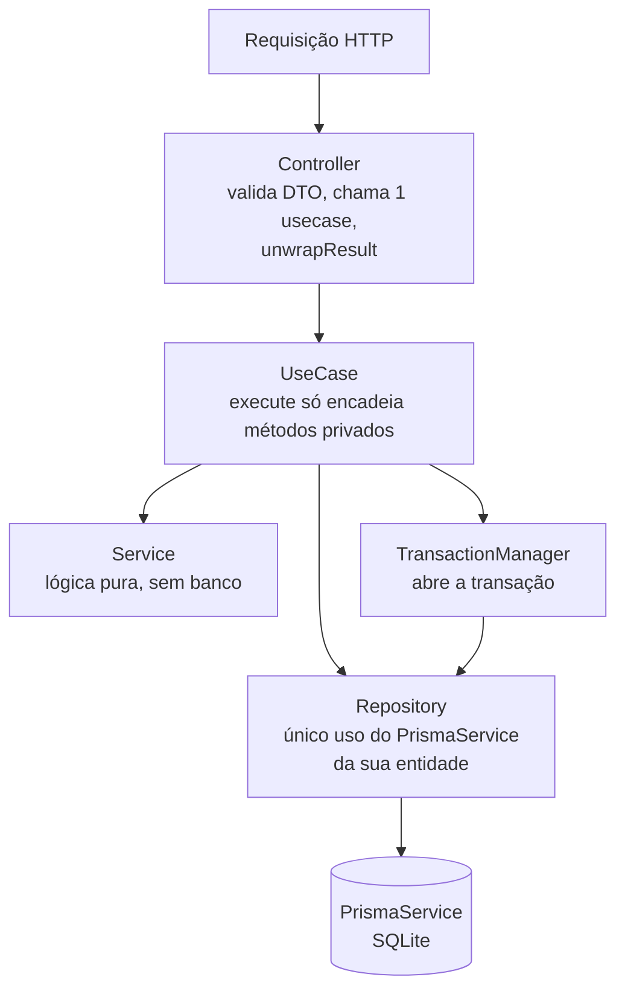
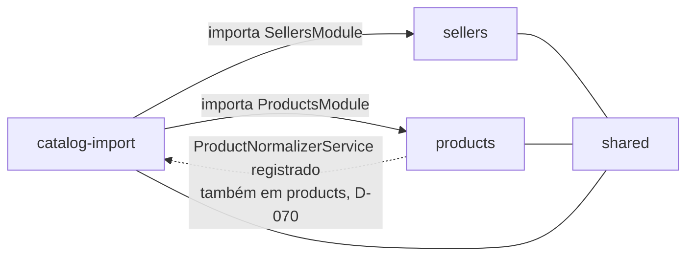
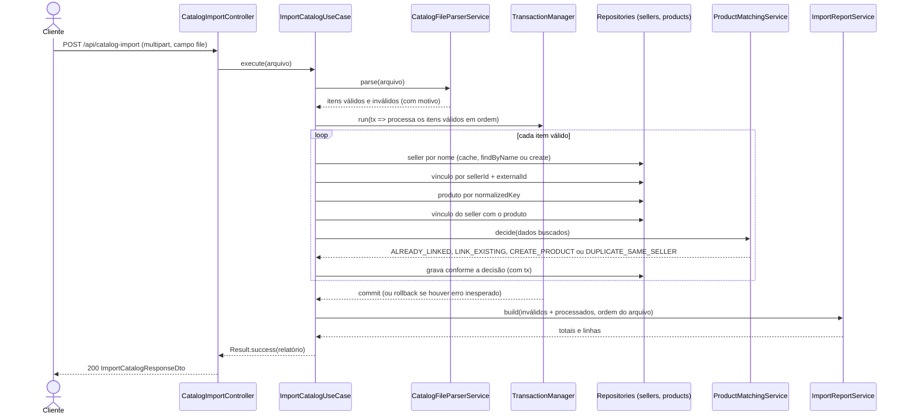

# Arquitetura

## Visão geral

O backend é uma API NestJS organizada em módulos (`backend/src/modules/`), com camadas fixas dentro de cada módulo: **Controller → UseCase → Service ou Repository**. O acesso ao banco fica só nos repositories (e no `TransactionManager`), que usam o `PrismaService` sobre um SQLite. Os erros esperados não são lançados: voltam como um `Result`, que o controller converte em resposta HTTP.

Os módulos são `catalog-import` (importação do arquivo de carga), `products` (catálogo e detalhe com sellers) e `sellers` (sellers e seus produtos). O `shared/` tem o que todos usam: `Result`, mapa de erros para HTTP, `TransactionManager` e `PrismaService`.

O frontend (React + Vite) só chama a API a partir de `src/api/`. Regras e decisões estão em `docs/context.md` e `docs/decisions.md`.

## Camadas

| Camada | Faz | Não faz |
|---|---|---|
| Controller | Recebe HTTP, valida DTO, converte o `Result` em resposta | Regra de negócio, acesso a repository |
| UseCase | Executa uma ação; regra nos métodos privados, que devolvem `Result` | SQL direto, `throw` para erro esperado |
| Service | Lógica de domínio pura (normalização, matching, relatório) | Banco, conhecer HTTP |
| Repository | Consultas nomeadas pelo propósito, aceita `tx` opcional | Regra de negócio |

## Módulos e dependências

- `catalog-import` importa `sellers` (para `SellerRepository` e `SellerProductRepository`) e `products` (para `ProductRepository`). Pelo `Module` de cada um, nunca pelo arquivo.
- `products` lê os sellers de um produto pela própria relação (`findByIdWithSellers`, D-024), então não depende de `sellers`.
- `ProductNormalizerService` é o service puro da regra de chave (D-025). `products` também o registra no próprio módulo para a busca (D-070).
- `shared/` não conhece módulo nenhum: guarda o mapa `code → HTTP` (cada módulo registra os seus, D-032).

## Fluxo de ponta a ponta: importação

Pontos do fluxo:

- Item inválido (`Id`, `SellerName` ou `Name` vazios, tipo errado) não entra na transação: é só reportado com o motivo (D-011, D-082).
- A deduplicação dentro do arquivo vem da ordem: o item 50 encontra o produto criado pelo item 3, porque os dois rodam na mesma transação (D-080).
- Erro esperado de arquivo (JSON inválido, array vazio, arquivo ausente) responde 400 antes de abrir a transação (D-081).
- Detalhes das regras de matching estão em `docs/modules/catalog-import.md` e em `docs/decisions.md` (D-005, D-012, D-040).

## Padrão Result

Tipo único em `backend/src/shared/result/result.ts`: `ResultSuccess<T>` ou `ResultError<E>`, com `isSuccess`/`isFailure`, `value` ou `error`. Erro de negócio é um objeto tipado com `code` e `message`, definido em `schemas/<modulo>.errors.ts`.

- Usecase: `execute()` devolve `Promise<Result<Output, AppError>>` e só encadeia métodos privados. Cada método privado devolve `Result`. A única condicional do `execute()` é `if (x.isFailure) return x;`.
- Controller: `unwrapResult(result)` (em `shared/errors/`) devolve o valor mapeado para o response DTO no sucesso. No erro, lança a `HttpException` do `code`, consultando o mapa `code → HTTP` (D-032). Código sem registro vira 500.
- `throw` fica para erro inesperado (bug, banco fora do ar). O `all-exceptions.filter.ts` global trata esses casos.

## Transação

Operações que gravam em mais de uma tabela rodam numa transação só. O usecase não chama `prisma.$transaction`: ele injeta o `TransactionManager` de `shared/prisma/`, que executa o trabalho dentro da transação e faz rollback quando o trabalho devolve `Result.error`.

Na importação, a transação cobre o arquivo inteiro (D-080). Um erro inesperado desfaz tudo e responde 500, então nenhuma importação parcial fica gravada. Reimportar o mesmo arquivo não altera contagens (D-007): as constraints `unique` do banco são a garantia final.

## Referências

- Banco e migrations: [`database.md`](database.md)
- Módulos: [`modules/catalog-import.md`](modules/catalog-import.md), [`modules/products.md`](modules/products.md), [`modules/sellers.md`](modules/sellers.md)
- Decisões: [`decisions.md`](decisions.md)
