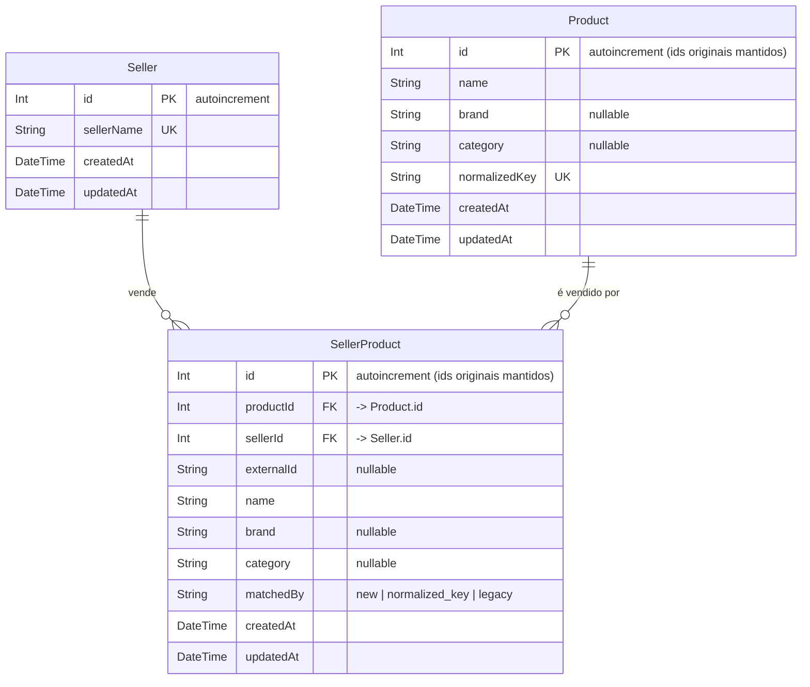

# Contexto e regras de negócio: Catalog Consolidation

> Documento de requisitos fornecido pelo usuário, guardado no repositório para que cada subagente leia as seções do seu escopo. Referenciado no `docs/plan.md` como "ctx §N".

---

## 1. O problema

Um e-commerce tradicional vai passar a operar como **marketplace**: além dos próprios produtos, vai vender produtos de outras lojas (**sellers**).

- Cada seller envia seus produtos, que devem ser adicionados ao catálogo.
- O mesmo produto costuma ser vendido por vários sellers, e cada um cadastra seus dados do seu jeito. Por isso **o mesmo item pode chegar com pequenas variações**.
- **Duplicar produtos não é aceitável.** Se o produto já existe, ele **não** é inserido de novo na tabela de produtos. O sistema só **vincula o produto existente ao seller**.
- É obrigatório registrar **quais sellers oferecem cada produto**.

O banco fornecido é um **SQLite** já populado com 2 tabelas, as duas com **ids inteiros**:
1. tabela de **produtos**;
2. tabela que **liga produtos a sellers**.

### Prioridades da avaliação
- **Mostrar domínio do problema e entendimento da solução vale mais** do que uma implementação escalável e pronta para produção. Não exagere na infraestrutura.
- O enunciado tem **ambiguidades de propósito**, e elas fazem parte da avaliação. **Nunca resolva uma ambiguidade em silêncio.** Toda decisão vai para `docs/decisions.md`.
- **É permitido alterar o banco** quando fizer sentido. Toda alteração passa por migration e fica documentada.

---

## 2. Arquivo de carga

O arquivo é um **JSON com um array** de itens neste formato:

```json
[
  {
    "Id": "a1b2c3d4-e5f6-4a5b-8c9d-0e1f2a3b4c5d",
    "SellerName": "MegaStore",
    "Name": "Smartphone Galaxy S23",
    "Brand": "Samsung",
    "Category": "Electronics"
  }
]
```

O arquivo real está em `database/fixtures/carga.json` e é usado nos testes e2e.

### O que a análise do arquivo mostrou

| Fato | Números |
|---|---|
| Total de itens | 269 |
| Sellers diferentes | 20 |
| Itens com `Id` fora do formato UUID | 3 (`ddddeee-ffff-...`, `09835342345-...`, `uddd0000-...`). **São válidos**: o `Id` é texto livre (ver conclusão abaixo) |
| `Id`s repetidos | 14 |
| Desses, mesmo `Id` em **sellers diferentes com produtos totalmente diferentes** | 13 (ex.: `00112233-4455-4667-7889-900112233445` é "Curtain Rod" na GardenStore e "Bookshelf" na SportsHub) |
| Desses, mesmo `Id` no **mesmo seller** | 1 (`e5e5e5e5-...` na GardenStore: "Câmera Canon EOS R6" e "Camera Canon EOS R6") |
| O mesmo produto em sellers diferentes chega com o mesmo `Id`? | **Nunca.** Ex.: "Smartphone Galaxy S23" tem um `Id` na MegaStore e outro na FitnessCenter |
| Mesmo produto repetido no **mesmo seller com `Id`s diferentes** | 11 casos (ex.: OfficeSupply envia "Basketball Spalding Official" e "Basketball Spalding  Official") |
| Itens com `Brand: null` | 3 |
| Item com tentativa de SQL injection | 1 (`"Brand": "TestBrand'; SELECT 1; --"`, seller MegaStore). É um item **válido** e precisa ser gravado com o texto exato |

Variações que aparecem entre itens que são o mesmo produto:
- **espaços duplos** (a grande maioria): `"iPhone 15 Pro"` × `"iPhone 15  Pro"`;
- **acento**: `"Câmera Canon EOS R6"` × `"Camera Canon EOS R6"`;
- **aspas de polegada**: `12.9"` × `12.9''` × `12.9`, e `55"` × `55`;
- **categoria diferente** para o mesmo produto: `"Photography"` × `"Photo"`;
- **tradução** (português × inglês): `"Roteador WiFi 6 TP-Link"` × `"Router WiFi 6 TP-Link"` e `"Processador AMD Ryzen 9 7950X"` × `"Processor AMD Ryzen 9 7950X"`.

### Conclusão: o que o `Id` do arquivo significa

O `Id` **é o identificador do produto dentro da loja do seller**, válido só no escopo daquele seller:
- ele é **texto livre**, definido por cada seller. A maioria parece UUID, mas **não precisa ser**: não valide o formato, só que ele existe e não está vazio;
- ele **não** identifica o produto entre lojas (o mesmo produto tem `Id`s diferentes em cada seller), então **não serve para achar duplicatas**;
- ele **não** é único globalmente (13 `Id`s se repetem entre sellers para produtos diferentes). **Uma constraint `unique` só no `Id` quebraria a importação.** A unicidade é sempre `(sellerId, externalId)`;
- ele **nunca** é usado como `id` do nosso banco. Os nossos ids continuam inteiros, e o `Id` do arquivo é guardado como `externalId`.

---

## 3. Modelo de dados (decisões já tomadas)

O `schema.prisma` final deve seguir a modelagem abaixo (ver D-022: o arquivo não foi fornecido, então é escrito a partir desta seção). **Não invente outro modelo.**

### Diagrama



**Constraints unique**
- `Seller (sellerName)`
- `Product (normalizedKey)`
- `SellerProduct (productId, sellerId)`
- `SellerProduct (sellerId, externalId)`

### Tabelas

| Model           | Papel                                                                                     |
|-----------------|-------------------------------------------------------------------------------------------|
| `Seller`        | O seller. Tabela **nova**: o banco fornecido tem só produtos e vínculo.                   |
| `Product`       | O produto **oficial** do catálogo. Existe uma única vez, não importa quantos sellers o vendem. |
| `SellerProduct` | O vínculo N:N entre seller e produto, junto com **os dados como aquele seller enviou**.   |

### Identificadores
- Todos os `id` são **inteiros com autoincremento**, e todas as FKs são `Int`.
- **Os ids originais do banco fornecido são mantidos.** A tabela nova `Seller` segue o mesmo padrão.
- **uuid foi considerado e descartado.** Trocar a chave primária das tabelas fornecidas exigiria uma migration manual (o SQLite não altera o tipo de coluna e não gera uuid nativamente), refazer todas as FKs e verificar se nenhum vínculo se perdeu. O ganho é pequeno num sistema sem autenticação nem exposição pública. Princípio: **só alterar o banco fornecido onde for necessário.**
- **Não troque os ids para uuid** nem renumere os ids existentes.

### `Seller`
- `sellerName` é **unique**: é por ele que o seller é encontrado na importação (o arquivo só traz o nome).
- **Sem senha e sem autenticação.** Login de seller está fora do escopo.

### `Product`
- Guarda a versão oficial: `name` (obrigatório), `brand` e `category` (**opcionais**, porque o arquivo pode trazer `null` nesses campos e o produto é criado a partir dos dados do seller).
- `normalizedKey` é **unique** e obrigatório. É a garantia, **no banco**, de que não existem produtos duplicados, não só uma regra no código.
- **Não existe coluna `ean`**: o arquivo não traz EAN, e uma coluna que nunca é preenchida não deve existir.
- O `Product` nunca é sobrescrito com os dados de um seller. A versão oficial é a do **primeiro seller que criou o produto**.

### `SellerProduct`
- `UNIQUE (productId, sellerId)`: um seller nunca é vinculado duas vezes ao mesmo produto.
- `externalId`: o `Id` do arquivo, como **texto livre**, com `UNIQUE (sellerId, externalId)`. Nunca `unique` sozinho.
  - **Obrigatório na importação:** todo vínculo criado pelo arquivo tem `externalId`.
  - **Opcional no banco:** os vínculos que já existiam no banco fornecido podem não ter esse código, então a coluna aceita `null`. No SQLite, vários `null` não violam o índice unique.
- Guarda **sempre o que o seller enviou**, mesmo que seja igual ao oficial:
  - `name` é **obrigatório**;
  - `brand` e `category` são opcionais, e `null` significa **apenas** "não veio no arquivo". Nunca use `null` para dizer "igual ao oficial".
- `matchedBy` é obrigatório e registra a origem do vínculo:
  - `"new"`: o item do arquivo criou o produto;
  - `"normalized_key"`: o item do arquivo foi ligado a um produto existente pela chave;
  - `"legacy"`: o vínculo já existia no banco fornecido e foi trazido pela migration.

### Migration do banco fornecido para este modelo

A migration é escrita à mão (`prisma migrate dev --create-only` + SQL editado), depois da baseline do banco original, e roda nesta ordem:

1. **Cria a tabela `Seller`** e a popula com um registro para cada seller distinto que aparece na tabela de vínculo original.
2. **Recria a tabela de vínculo como `SellerProduct`** (o SQLite não altera colunas, então a tabela é recriada e os dados copiados), **mantendo os ids originais**:
   - `sellerId` aponta para o `Seller` criado no passo 1;
   - `externalId` recebe `CAST(SellerProductId AS TEXT)` da coluna original (ver D-020; o requisito original dizia `null`, alterado com aprovação do usuário);
   - `matchedBy = 'legacy'`;
   - `name`, `brand` e `category`: se a tabela original tiver os dados do seller, usa esses dados; se não tiver, copia do `Product`. Registre qual dos dois casos aconteceu em `docs/database.md`.
3. **Adiciona `normalizedKey` ao `Product`**, ainda aceitando `null`.
4. **Backfill do `normalizedKey` dentro da própria migration**, com uma expressão SQL que aplica exatamente a mesma normalização da seção 4.
5. **Trata as duplicatas do banco original** antes de criar a constraint, para a migration não quebrar:
   - para cada grupo de produtos com o mesmo `normalizedKey`, o **produto canônico é o de menor `id`** (o mais antigo);
   - os `SellerProduct` dos produtos duplicados passam a apontar para o canônico;
   - se isso gerar dois vínculos do mesmo seller com o mesmo produto, fica o de menor `id` e o outro é removido;
   - os produtos duplicados, já sem vínculos, são removidos.
6. **Torna o `normalizedKey` obrigatório e cria as constraints unique** da lista acima.
7. **Confere o resultado:** quantidade de produtos e vínculos antes e depois, quantos produtos foram unidos, quantos vínculos foram redirecionados e quantos removidos. Esses números vão para `docs/database.md`.

### Equivalência entre SQL e TypeScript
Com o backfill na migration, a normalização passa a existir em **dois lugares**: no SQL da migration e na função TypeScript usada na importação. Se as duas divergirem, um produto do banco original não será reconhecido quando um seller enviar o mesmo item, e a constraint unique não vai impedir a duplicata.

Por isso:
- o SQL replica cada passo da seção 4: troca dos caracteres acentuados (maiúsculos e minúsculos) pelos equivalentes sem acento **antes** do `lower()` (o `lower()` do SQLite só converte ASCII), remoção de `"` e `'`, `replace` repetido para juntar espaços e `trim`;
- existe um **teste de consistência** que lê todos os produtos depois da migration, recalcula a chave com a função TypeScript e falha se qualquer `normalizedKey` gravado for diferente;
- se a regra de normalização mudar, os dois lugares mudam no mesmo PR, com uma migration nova recalculando as chaves.

---

## 4. Identificação de duplicatas (matching)

Esta é a regra mais importante do projeto. Ela precisa estar **explícita, isolada num service de matching, testada e documentada**.

### Normalização
A função TypeScript que gera o `normalizedKey` é **única** na aplicação. O backfill da migration replica essa regra em SQL, com o teste de consistência descrito na seção 3. A normalização aplica, nesta ordem:
1. remove acentos (`Câmera` → `camera`);
2. converte para minúsculas;
3. remove aspas simples e duplas, incluindo `''` usado como polegada (`12.9"`, `12.9''` e `12.9` ficam iguais);
4. troca qualquer sequência de espaços por um espaço só e faz trim.

A chave tem o formato `<marca normalizada>|<nome normalizado>`. Se a marca for `null` ou vazia, a parte da marca fica vazia: `|<nome normalizado>` (ex.: `|cable organizer kit`). O separador `|` impede que uma marca vazia colida com uma marca preenchida. **A categoria não entra na chave**, porque varia entre sellers para o mesmo produto (`Photography` × `Photo`).

Se a regra de normalização mudar, a chave dos produtos existentes precisa ser recalculada.

### Ordem de verificação para cada item válido
0. **Mesmo `externalId` no mesmo seller:** se já existe um `SellerProduct` com o mesmo `(sellerId, externalId)`, é reenvio de um produto já vinculado. Não roda o matching; atualiza os dados enviados pelo seller e reporta como "já vinculado".
1. **Chave normalizada:** busca um `Product` com o mesmo `normalizedKey`. `matchedBy = "normalized_key"`.
2. **Nenhum match:** cria um `Product` novo a partir dos dados do seller. `matchedBy = "new"`.

Depois de achar o produto, se o seller **já está vinculado a ele** com outro `externalId` (o mesmo produto enviado duas vezes pelo mesmo seller), o item não cria um segundo vínculo. Ele é reportado como **"duplicado no mesmo seller"**, e vale o primeiro `externalId` recebido.

### Limitação conhecida: traduções
`"Roteador WiFi 6 TP-Link"` × `"Router WiFi 6 TP-Link"` e `"Processador AMD Ryzen 9 7950X"` × `"Processor AMD Ryzen 9 7950X"` são o mesmo produto, mas **não** são unidos pela chave normalizada. Isso é aceito na primeira versão, seguindo o princípio de que **é melhor criar um produto novo do que juntar dois produtos diferentes**. Evolução possível: um passo de similaridade restrito a produtos da **mesma marca** e com os **mesmos códigos de modelo** (tokens com dígitos, como `7950x`, `wifi 6`), com um novo valor `matchedBy = "similarity"`. **Não implemente isso agora.**

---

## 5. Módulos e fluxo

### `products`
Catálogo de produtos: listagem com filtro e paginação, e detalhe do produto **com a lista de sellers que o oferecem**.

### `sellers`
Sellers (model `Seller`) e o vínculo produto ↔ seller (model `SellerProduct`): listar sellers e os produtos de cada um, mostrando os dados como o seller enviou.

### `catalog-import`
Recebe o arquivo JSON, processa e consolida no catálogo. Fluxo do usecase de importação:

1. **Parse e validação** de cada item. Um item é **inválido** quando:
   - o `Id` está vazio ou ausente (o formato não é validado: qualquer texto serve);
   - `SellerName` ou `Name` estão vazios ou ausentes.

   Item inválido é **rejeitado e reportado** com o motivo, e **não derruba a importação**. `Brand` e `Category` podem ser `null`.
2. **Seller:** encontra pelo `sellerName` ou **cria automaticamente** na primeira vez que ele aparece.
3. **Normalização e matching**, seguindo a seção 4.
4. **Persistência**, dentro de **uma transação**:
   - produto novo → insere em `Product` e cria o `SellerProduct`;
   - produto existente → **não insere** em `Product`, só cria o `SellerProduct`;
   - vínculo já existente → não duplica (a operação é **idempotente**).
5. **Relatório** de retorno, com totais e o detalhe de cada item:
   - lidos;
   - inválidos (com o motivo);
   - produtos criados (`new`);
   - vinculados a um produto existente (`normalized_key`);
   - já vinculados (reenvio do mesmo `externalId`);
   - duplicados no mesmo seller.

A deduplicação vale **dentro do próprio arquivo**: o item 50 pode ser o mesmo produto que o item 3.

**Segurança:** a proteção contra SQL injection vem das queries parametrizadas (`CLAUDE.md` §5, "Segurança: SQL injection"), **não da validação**. Nenhuma validação deste fluxo rejeita o item com `"TestBrand'; SELECT 1; --"`: ele é válido, é processado como qualquer outro e o `brand` é gravado exatamente com esse texto, sem executar nada. Os dados também não são "limpos": o arquivo tem `"Brand": "Levi's"`, e remover aspas quebraria um dado legítimo.

---

## 6. Ambiguidades

Todas as decisões estão em `docs/decisions.md` (D-001…D-025). Se surgir uma ambiguidade nova, **pare, registre e siga com a opção mais conservadora**.

---

## 7. Frontend

Escopo enxuto e funcional, que demonstre o fluxo:
- **Importação:** upload do arquivo e exibição do relatório, com totais por tipo de resultado e o motivo de cada item.
- **Catálogo:** lista de produtos com busca e paginação.
- **Detalhe do produto:** dados oficiais do produto e **lista de sellers que o vendem**, com o nome, a marca e a categoria como cada seller enviou e o `matchedBy` de cada vínculo. Essa tela é a melhor forma de mostrar a consolidação funcionando.

---

## 8. Testes específicos do domínio

- **Normalização:** testes unitários com os casos reais do arquivo: espaços duplos, acento, aspas de polegada (`"`, `''`, sem aspas), maiúsculas, marca `null`. E também com nomes parecidos que **não** são o mesmo produto (ex.: `"Vacuum Cleaner Upright"` × `"Vacuum Cleaner Cordless"`).
- **Usecase de importação:**
  - produto novo (`new`);
  - produto existente encontrado por chave normalizada (`normalized_key`);
  - reenvio do mesmo `externalId` pelo mesmo seller;
  - o mesmo `Id` em sellers diferentes com produtos diferentes (precisa criar dois vínculos, sem conflito);
  - o mesmo produto enviado duas vezes pelo mesmo seller com `Id`s diferentes;
  - item com `Id` fora do formato UUID (aceito normalmente);
  - item sem `Id`, sem `SellerName` ou sem `Name` (rejeitado e reportado);
  - item com `Brand: null`;
  - item com tentativa de SQL injection: é gravado, o `brand` salvo é exatamente `TestBrand'; SELECT 1; --` e as tabelas continuam íntegras;
  - item com aspas legítimas (`Levi's`) gravado sem alteração;
  - seller novo criado automaticamente.
- **Migration:** teste de consistência do `normalizedKey` (SQL × TypeScript) em todos os produtos; nenhum produto ou vínculo perdido além dos duplicados unidos; todo vínculo antigo com `matchedBy = 'legacy'`.
- **e2e** com `database/fixtures/carga.json`. Considerando **só o arquivo** (catálogo vazio), os números esperados são:

  | Resultado | Esperado |
  |---|---|
  | Itens lidos | 269 |
  | Inválidos | 0 |
  | Produtos criados (`new`) | 201 |
  | Vinculados a produto existente (`normalized_key`) | 56 |
  | Já vinculados (mesmo `externalId` no mesmo seller) | 1 |
  | Duplicados no mesmo seller | 11 |
  | Total de vínculos produto ↔ seller | 257 |
  | Produtos vendidos por mais de 1 seller | 54 |

  Com o banco real (975 produtos), a simulação feita no planejamento deu: 3 `new`, 254 `normalized_key`, 1 já vinculado, 11 duplicados, 257 vínculos, 54 produtos com mais de 1 seller, 978 produtos. O teste com o banco real confere as invariantes: nenhum `normalizedKey` repetido, nenhum vínculo repetido e reimportar o arquivo não muda nenhuma contagem.

---

## 9. Execução com subagentes

Ver `docs/plan.md`. Formato obrigatório da descrição de PR:

```md
## Resumo
O que este PR entrega, em 2 ou 3 frases.

## O que foi desenvolvido
- Lista dos módulos, arquivos e funcionalidades.

## Decisões
- Links para as entradas D-00X do decisions.md criadas ou usadas aqui.

## Como testar
Comandos e passos para conferir.

## Depende de
PRs que precisam ser mergeados antes (ou "nenhum").

## Checklist
- [ ] Itens da definição de pronto do CLAUDE.md que se aplicam a este PR.

## Execução
Modelo: <modelo> · Effort: <effort> · Retentativas: <n> · Tokens: <se disponível>
```

Regras: cada subagente trabalha na sua branch/worktree; commits pequenos `tipo(modulo): descrição`; push da branch e `gh pr create --base main`; **ninguém faz push direto na `main` e ninguém faz merge de PR**.

---

## 10. Critério de aceite

Além da definição de pronto do `CLAUDE.md`:
- [ ] Nenhum produto duplicado é criado (nenhum `normalizedKey` repetido).
- [ ] Todo vínculo seller ↔ produto é registrado, com o `matchedBy` correto.
- [ ] Os números do e2e com catálogo vazio batem com a tabela da seção 8.
- [ ] Reimportar o mesmo arquivo não altera a quantidade de produtos nem de vínculos.
- [ ] A migration roda no banco fornecido sem erro, une as duplicatas existentes e passa no teste de consistência do `normalizedKey`.
- [ ] O item com tentativa de SQL injection é gravado com o texto exato, sem executar nada.
- [ ] Os itens rejeitados (se houver) aparecem no relatório com o motivo.
- [ ] Todas as decisões estão registradas em `docs/decisions.md`.
- [ ] Cada subagente abriu seu PR para `main`, e o `docs/plan.md` tem o previsto × realizado.
