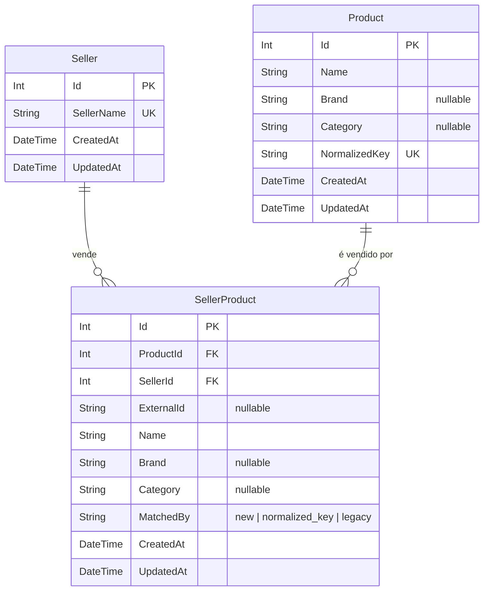

# Banco de dados

Documenta o banco fornecido, o schema final e a migration que leva de um ao outro. A fonte do modelo é `backend/prisma/schema.prisma`; as regras de negócio estão em `docs/context.md` §3 e as decisões em `docs/decisions.md` (D-002, D-003, D-005, D-018 a D-022, D-050 a D-056).

O banco original `database/catalog.db` nunca é alterado. O desenvolvimento usa a cópia `database/catalog.dev.db` (ignorada no git), apontada por `DATABASE_URL` no `backend/.env`.

## Schema original (banco fornecido)

```sql
CREATE TABLE Product (Id INTEGER PRIMARY KEY AUTOINCREMENT, Name TEXT NOT NULL, Brand TEXT, Category TEXT);
CREATE TABLE SellerProduct (
  Id INTEGER PRIMARY KEY AUTOINCREMENT,
  SellerName TEXT NOT NULL,
  ProductId INTEGER CONSTRAINT FK_Product_Id REFERENCES Product (Id) NOT NULL,
  SellerProductId INTEGER NOT NULL
);
```

| Tabela | Linhas | Observações |
|---|---|---|
| `Product` | 975 | ids 1 a 975; 119 `Brand` nulos; 34 `Category` nulas; nenhum caractere fora de ASCII; 0 grupos de duplicata por `normalizedKey` |
| `SellerProduct` | 0 | vínculo vazio: sem sellers no banco |

## Schema final



Constraints unique: `Seller (SellerName)`, `Product (NormalizedKey)`, `SellerProduct (ProductId, SellerId)`, `SellerProduct (SellerId, ExternalId)`. Nenhum índice além desses (D-051).

Nos models do Prisma os campos são `camelCase` (`normalizedKey`, `externalId`...), mapeados com `@map`/`@@map` para as colunas em PascalCase (D-050).

## Diferenças entre o original e o final

| Item | Original | Final |
|---|---|---|
| `Seller` | não existe | tabela nova, criada dos `SellerName` distintos do vínculo (D-002) |
| `Product.NormalizedKey` | não existe | `TEXT NOT NULL UNIQUE`, `marca normalizada\|nome normalizado` (D-005) |
| `Product.CreatedAt/UpdatedAt` | não existem | novas, obrigatórias; registros existentes recebem o momento da migration (D-053) |
| `SellerProduct.SellerName` | texto | removida; vira `SellerId` (FK para `Seller`) |
| `SellerProduct.SellerProductId` | `INTEGER NOT NULL` | removida; vira `ExternalId TEXT` nullable com `CAST(SellerProductId AS TEXT)` (D-020) |
| `SellerProduct.Name/Brand/Category` | não existem | dados como o seller enviou; nos vínculos legados, copiados do `Product` |
| `SellerProduct.MatchedBy` | não existe | obrigatório; vínculos legados recebem `legacy` |
| `SellerProduct.CreatedAt/UpdatedAt` | não existem | novas, obrigatórias |
| FK de `ProductId` | `NO ACTION / NO ACTION` | `RESTRICT / CASCADE` (D-056) |
| Ids | inteiros autoincrement | mantidos, sem renumerar (D-003); `sqlite_sequence` preservado |

## Migrations aplicadas

| Migration | O que faz |
|---|---|
| `0_init` | Baseline do banco fornecido, gerada com `prisma migrate diff --from-empty --to-schema-datamodel`. Marcada como aplicada (`prisma migrate resolve --applied 0_init`), sem executar nada. |
| `20261114041027_consolidate_catalog` | Migration escrita à mão (`prisma migrate dev --create-only` + SQL reescrito). Passos abaixo. |

### `consolidate_catalog`, passo a passo

1. Guarda o `sqlite_sequence` de `Product` e `SellerProduct` (restaurado no fim, D-054).
2. Cria `Seller` com um registro por `SellerName` distinto, na ordem do primeiro vínculo.
3. Recria `SellerProduct` mantendo os ids: `SellerId` do `Seller` criado, `ExternalId = CAST(SellerProductId AS TEXT)`, `MatchedBy = 'legacy'`. **Caso de `Name`, `Brand` e `Category`: a tabela original não guarda os dados do seller, então são copiados do `Product` do vínculo, antes de qualquer redirecionamento.** Hoje o efeito é nulo, porque a tabela tem 0 linhas.
4. Adiciona `Product.NormalizedKey` (nulo).
5. Backfill do `NormalizedKey` em SQL (ver "Equivalência SQL × TypeScript").
6. Une duplicatas: canônico = menor `Id` por chave; vínculos dos duplicados passam a apontar para o canônico; se o mesmo seller ficar duas vezes no mesmo produto, fica o vínculo de menor `Id`; produtos duplicados são removidos. Se o mesmo seller tiver o mesmo `ExternalId` em produtos diferentes, o de menor `Id` mantém o código e os outros ficam com `ExternalId = NULL` (D-054).
7. Recria `Product` com `NormalizedKey NOT NULL`, mantendo ids e `sqlite_sequence`, e cria os quatro índices unique.

O SQL preserva os `PRAGMA foreign_keys`/`defer_foreign_keys` do padrão de redefinição do Prisma. O arquivo é só ASCII (acentos escritos com `char(N)`).

`prisma migrate diff --from-migrations prisma/migrations --to-schema-datamodel prisma/schema.prisma` não acusa diferença: o histórico reproduz exatamente o `schema.prisma`.

### Como aplicar numa cópia do banco fornecido

```bash
cp database/catalog.db database/catalog.dev.db        # nunca altere o original
cd backend
npx prisma migrate resolve --applied 0_init           # só uma vez: o banco fornecido não tem _prisma_migrations
npx prisma migrate deploy
```

## Números antes e depois (banco real)

| Medida | Antes | Depois |
|---|---|---|
| Produtos | 975 | 975 |
| Vínculos | 0 | 0 |
| Sellers | 0 | 0 |
| Produtos unidos (duplicatas removidas) | - | 0 |
| Vínculos redirecionados | - | 0 |
| Vínculos removidos (repetidos) | - | 0 |
| `ExternalId` zerados por conflito | - | 0 |
| `sqlite_sequence` de `Product` | 975 | 975 |
| `normalizedKey` distintos | - | 975 |
| `PRAGMA foreign_key_check` | - | sem violações |

O banco real não tem duplicatas nem vínculos, então a união, o redirecionamento e a remoção rodam sem efeito. Esses caminhos são exercitados com dados legados sintéticos em `backend/test/database/migration-legacy-data.e2e-spec.ts`:

| Medida (dados sintéticos sobre o banco real) | Antes | Depois |
|---|---|---|
| Produtos | 975 + 8 = 983 | 979 (4 unidos) |
| Vínculos | 8 | 7 (1 removido por repetição) |
| Vínculos redirecionados ao canônico | - | 3 |
| Sellers | 0 (texto no vínculo) | 2 |
| `ExternalId` zerados por conflito | - | 1 |

## Equivalência SQL × TypeScript

O `normalizedKey` do backfill é calculado em SQL; a importação o calcula com `ProductNormalizerService.buildKey`. A decisão completa e as nuances estão em D-052. Resumo:

- A migration troca as 161 letras acentuadas de Latin-1 Supplement e Latin Extended-A (À-ÿ, Ā-ž, incluindo ç/Ç e ñ/Ñ) pela letra sem acento antes do `lower()`, remove marcas combinantes soltas (U+0300 a U+036F), converte para minúscula as 12 maiúsculas sem decomposição NFD que o `toLowerCase()` do JS converte (`Ø`, `Æ`, `Ł`...), remove `"` e `'`, troca os espaços em branco do `\s` do JavaScript por espaço, junta repetições e faz `trim`.
- Letras sem decomposição NFD em minúscula (`ø`, `ß`, `æ`, `đ`, `ł`) não são trocadas, nem no TS nem no SQL.
- Fora de Latin-1 Supplement e Latin Extended-A, o SQL não remove acento (o TS remove) e o `lower()` só converte ASCII. O banco fornecido é todo ASCII, então nada muda hoje.
- Se a regra de normalização mudar, SQL e TypeScript mudam no mesmo PR, com uma migration nova recalculando as chaves.

## Testes

Em `backend/test/database/`, rodados por `npm run test:e2e` (cada teste copia `database/catalog.db` para um arquivo temporário, marca `0_init` e roda `prisma migrate deploy`):

- `migration.e2e-spec.ts`: banco real. 975 produtos, 0 unidos, 0 vínculos, nenhum `normalizedKey` repetido ou vazio, ids preservados (produto 1 continua "Knife Set Professional"), próximo id 976, sem violação de FK, banco original intacto.
- `migration-legacy-data.e2e-spec.ts`: dados legados sintéticos. Produtos duplicados por espaço duplo, acento, aspas e caixa; vínculos apontando para eles; vínculo repetido; `ExternalId` em texto; sellers criados; dados copiados do produto original; id do produto removido não é reaproveitado.
- `normalized-key-consistency.e2e-spec.ts`: lê todos os produtos depois da migration e compara `normalizedKey` com `ProductNormalizerService.buildKey`. Inclui o banco real e casos sintéticos para cada letra de U+00C0 a U+017F, espaços Unicode, aspas, `''`, marca nula ou vazia e texto já decomposto.