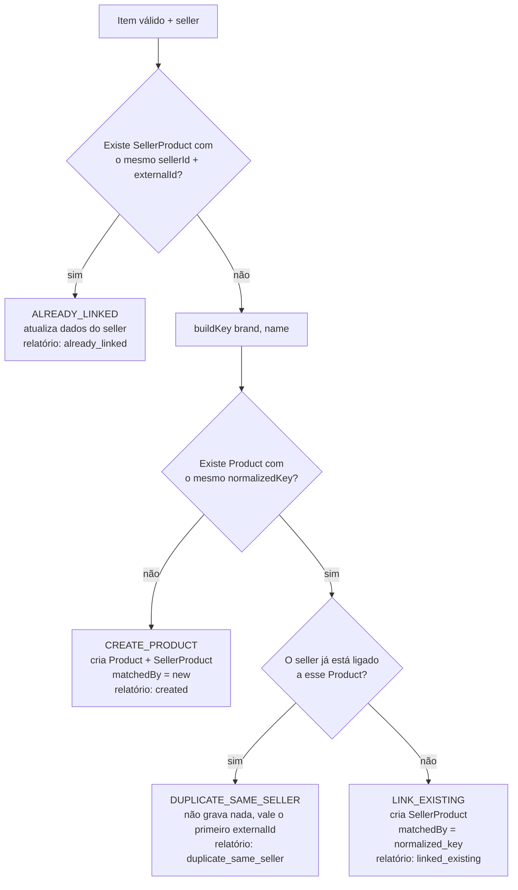

# Módulo: catalog-import

## Responsabilidade

> Parcial: esta seção será completada na Onda 5 (usecase de importação).

O módulo recebe o arquivo JSON de carga e consolida os itens no catálogo. Nesta etapa ele já contém a **regra de identificação de duplicatas**, isolada em dois services puros:

- `ProductNormalizerService`: gera o `normalizedKey` (`<marca>|<nome>`) usado para reconhecer o mesmo produto entre sellers;
- `ProductMatchingService`: aplica a ordem de verificação de cada item válido e devolve uma decisão (criar produto, ligar a produto existente, já vinculado, duplicado no mesmo seller).

O que o módulo **não** faz nos services: acessar o banco, validar o item, criar o seller ou gravar o vínculo. Isso é responsabilidade do usecase (Onda 5), que busca os dados, pede a decisão e executa a gravação dentro da transação.

## Endpoints

A completar na Onda 5.

## Fluxo

A completar na Onda 5 (fluxo completo do usecase). Abaixo, só o fluxo de decisão do matching para um item já validado:

## Regras de negócio

### Normalização (D-005)

`ProductNormalizerService.normalize(text)` aplica, nesta ordem:

1. remove acentos: `text.normalize('NFD')` e remoção das marcas combinantes (`\p{M}`), ex.: `Câmera` → `Camera`;
2. converte para minúsculas;
3. remove todas as aspas simples e duplas, incluindo o `''` usado como polegada (`12.9"`, `12.9''` e `12.9` ficam iguais);
4. troca qualquer sequência de whitespace (`\s+`: espaço, tab, quebra de linha) por um espaço e faz `trim()`.

`null`, `undefined` e texto vazio viram `''`.

`ProductNormalizerService.buildKey(brand, name)` devolve `<marca normalizada>|<nome normalizado>`:

- marca `null`, `undefined` ou vazia gera `|<nome normalizado>` (ex.: `|cable organizer kit`);
- o separador `|` impede que uma marca vazia colida com uma marca preenchida (`|organizer kit` ≠ `organizer|kit`);
- **a categoria não entra na chave**, porque varia entre sellers para o mesmo produto (`Photography` × `Photo`). Ela nem é argumento do método.

A chave serve só para comparação. O dado enviado pelo seller **nunca** é alterado: `Levi's` gera `levis` na chave, mas continua gravado como `Levi's`; `TestBrand'; SELECT 1; --` gera uma chave determinística e é gravado com o texto exato (a proteção contra SQL injection vem das queries parametrizadas).

A mesma regra é replicada em SQL no backfill da migration (D-019). Por isso ela não pode ganhar passos novos sem mudar o SQL e recalcular as chaves no mesmo PR.

### Ordem de verificação (D-012, D-015, D-040)

Para cada item válido, `ProductMatchingService.decide(input)` recebe o que o usecase já buscou e devolve uma decisão:

| Ordem | Condição | Decisão | `matchedBy` | Resultado no relatório |
|---|---|---|---|---|
| 0 | já existe vínculo com o mesmo `(sellerId, externalId)` | `ALREADY_LINKED` | (mantém o do vínculo) | `already_linked` |
| 1a | existe `Product` com o mesmo `normalizedKey` e o seller já está ligado a ele | `DUPLICATE_SAME_SELLER` | (nenhum vínculo novo) | `duplicate_same_seller` |
| 1b | existe `Product` com o mesmo `normalizedKey` e o seller não está ligado a ele | `LINK_EXISTING` | `normalized_key` | `linked_existing` |
| 2 | nenhum `Product` com a chave | `CREATE_PRODUCT` | `new` | `created` |

- O passo 0 tem prioridade sobre todos os outros: o matching nem roda.
- A decisão é **por seller**: o mesmo `Id` em sellers diferentes não conflita, porque o vínculo é buscado pelo par `(sellerId, externalId)`.
- Duplicado no mesmo seller: vale o primeiro `externalId` recebido; o segundo não é guardado (D-012). Um vínculo legado sem `externalId` também conta como vínculo existente.
- **Deduplicação dentro do próprio arquivo:** o service não guarda estado. Ela acontece porque o usecase grava item a item na mesma transação, então o produto criado pelo item 3 já é encontrado pela chave quando o item 50 é processado.

### Limitação conhecida: traduções (D-016)

`"Roteador WiFi 6 TP-Link"` × `"Router WiFi 6 TP-Link"` e `"Processador AMD Ryzen 9 7950X"` × `"Processor AMD Ryzen 9 7950X"` são o mesmo produto, mas geram chaves diferentes e viram produtos separados. É aceito na primeira versão: é melhor criar um produto novo do que unir dois produtos diferentes. Evolução possível: passo de similaridade restrito à mesma marca e aos mesmos códigos de modelo, com `matchedBy = "similarity"`. Não implementado.

## Componentes

| Componente | Arquivo | Papel |
|---|---|---|
| `ProductNormalizerService` | `services/product-normalizer.service.ts` | Normaliza texto e monta o `normalizedKey`. Puro, sem estado. |
| `ProductMatchingService` | `services/product-matching.service.ts` | Decide o destino de um item válido a partir dos dados já buscados (`decide`) e converte a decisão no resultado do relatório (`toOutcome`). Puro, sem repository. |
| Tipos de domínio | `schemas/catalog-import.types.ts` | Enums `MatchedBy`, `ImportItemOutcome`, `MatchDecisionType`; `MatchInput` e a união discriminada `MatchDecision`. |

UseCases, repositories, DTOs e controller: a completar na Onda 5.

## Decisões relacionadas

- [D-005](../decisions.md#d-005--critério-de-mesmo-produto-normalizedkey--marca--nome-normalizados) — critério de "mesmo produto".
- [D-012](../decisions.md#d-012--mesmo-produto-enviado-duas-vezes-pelo-mesmo-seller-vale-o-primeiro) — duplicado no mesmo seller.
- [D-015](../decisions.md#d-015--registrar-o-critério-de-match-matchedby) — `matchedBy`.
- [D-016](../decisions.md#d-016--traduções-não-são-unidas-limitação-conhecida) — traduções.
- [D-019](../decisions.md#d-019--backfill-do-normalizedkey-em-sql--teste-de-consistência) — regra replicada em SQL.
- [D-025](../decisions.md#d-025--normalização-e-matching-no-módulo-catalog-import) — localização dos services.
- [D-040](../decisions.md#d-040--formato-da-decisão-do-matching) — formato da decisão do matching.

## Testes

Em `backend/src/modules/catalog-import/__tests__/`:

- `product-normalizer.service.spec.ts`: `null`/`undefined`/vazio, espaços duplos, tabs e quebras de linha nas pontas e no meio, acentos (inclusive texto já decomposto), maiúsculas, aspas de polegada (`12.9"` × `12.9''` × `12.9`, `55"` × `55`), idempotência, marca `null`/`undefined`/vazia → `|nome`, marca vazia não colide com marca preenchida, categoria fora da chave, `Levi's` → `levis` só na chave, chave determinística para `TestBrand'; SELECT 1; --`, e pares que **não** são o mesmo produto (`Vacuum Cleaner Upright` × `Vacuum Cleaner Cordless`, marcas diferentes, traduções da D-016).
- `product-matching.service.spec.ts`: cada ramo da decisão, prioridade do `ALREADY_LINKED`, duplicado no mesmo seller (inclusive com vínculo legado sem `externalId`), mesmo `Id` em sellers diferentes, entrada inconsistente (`sellerLinkToProduct` sem produto) e a conversão `toOutcome`.
- `carga-matching-simulation.spec.ts`: simula a importação de `database/fixtures/carga.json` com catálogo vazio, usando os dois services e estruturas em memória no lugar do banco. Confere os números de `docs/context.md` §8: 269 lidos, 0 inválidos, 201 `new`, 56 `normalized_key`, 1 já vinculado, 11 duplicados no mesmo seller, 257 vínculos e 54 produtos com mais de 1 seller.

Testes do usecase e e2e: a completar na Onda 5.
