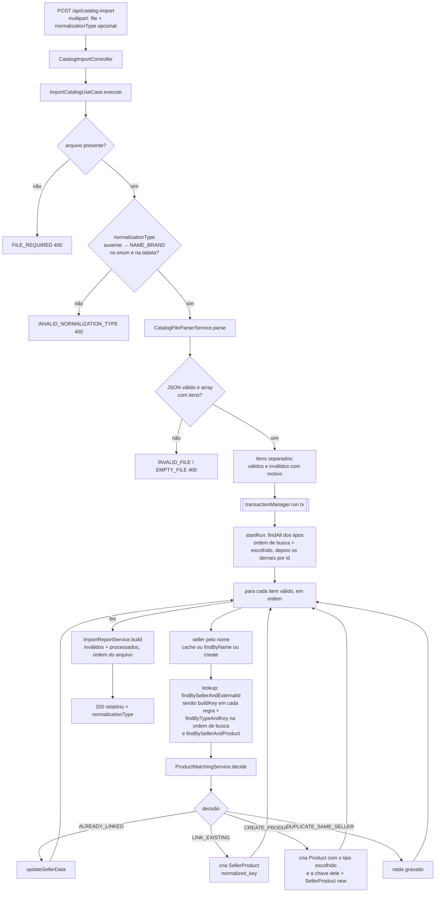
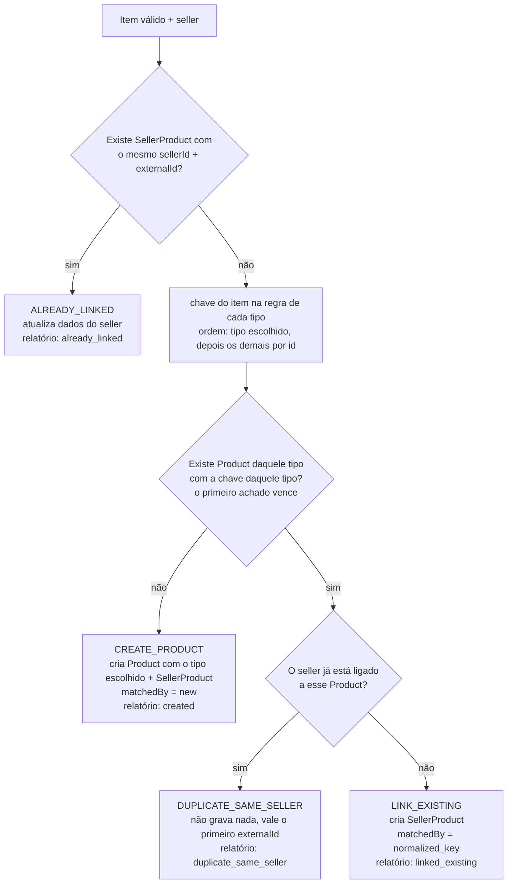

# Módulo: catalog-import

## Responsabilidade

Recebe o arquivo JSON de carga (`database/fixtures/carga.json` é o exemplo real) e, opcionalmente, o tipo de normalização da importação (`normalizationType`, padrão `NAME_BRAND`), valida cada item e consolida os itens válidos no catálogo **sem duplicar produtos**: cria o seller na primeira aparição, liga o item a um produto existente quando a chave normalizada bate (pela regra do próprio produto, D-112), cria o produto com o tipo escolhido quando não bate, e devolve um relatório com o resultado de cada item.

A regra de identificação de duplicatas fica isolada em dois services puros:

- `ProductNormalizerService`: gera o `normalizedKey` pela regra do tipo de normalização (`<marca>|<nome>` no padrão `NAME_BRAND`, `<categoria>|<nome>` em `NAME_CATEGORY`, `<marca>|<categoria>|<nome>` em `NAME_BRAND_CATEGORY`) usado para reconhecer o mesmo produto entre sellers;
- `ProductMatchingService`: aplica a ordem de verificação de cada item válido e devolve uma decisão (criar produto, ligar a produto existente, já vinculado, duplicado no mesmo seller).

O que o módulo **não** faz:

- não acessa `Product`, `Seller`, `SellerProduct` nem `NormalizationType` direto: usa os repositories exportados por `ProductsModule`, `SellersModule` e `NormalizationTypesModule`;
- não muda o tipo nem a chave de um produto existente;
- não "limpa" os dados do seller: o texto é gravado exatamente como veio (D-082); a normalização serve só para a chave;
- não valida o formato do `Id` (D-009) nem o tipo MIME do arquivo (D-083);
- não sobrescreve o `Product` oficial com dados de seller (D-013);
- não une traduções (D-016).

## Endpoints

| Método | Rota | Descrição | Request | Response |
|---|---|---|---|---|
| `POST` | `/api/catalog-import` | Importa o arquivo e consolida no catálogo, numa única transação. | `multipart/form-data` com o campo `file` (JSON, até 5 MB) e o campo de texto opcional `normalizationType` (`NAME_BRAND` \| `NAME_CATEGORY` \| `NAME_BRAND_CATEGORY`, padrão `NAME_BRAND`) | `200` `ImportCatalogResponseDto`; `400` `FILE_REQUIRED` / `INVALID_FILE` / `EMPTY_FILE` / `INVALID_NORMALIZATION_TYPE` / `VALIDATION_ERROR`; `413` arquivo acima de 5 MB |

Exemplos:

```bash
# tipo padrão (NAME_BRAND: marca + nome)
curl -F "file=@database/fixtures/carga.json" http://localhost:3000/api/catalog-import

# produtos novos com chave categoria + nome
curl -F "file=@database/fixtures/carga.json" -F normalizationType=NAME_CATEGORY http://localhost:3000/api/catalog-import
```

### Parâmetro `normalizationType` (D-113)

| Valor | Chave dos produtos criados |
|---|---|
| ausente | igual a `NAME_BRAND` (`DEFAULT_NORMALIZATION_TYPE_CODE`) |
| `NAME_BRAND` | `<marca>\|<nome>` (formato legado) |
| `NAME_CATEGORY` | `<categoria>\|<nome>` |
| `NAME_BRAND_CATEGORY` | `<marca>\|<categoria>\|<nome>` |
| outro (inclusive vazio ou outra caixa) | `400 INVALID_NORMALIZATION_TYPE`, nada gravado |

A lista dos tipos vem de `GET /api/normalization-types` (módulo [normalization-types](normalization-types.md)). O tipo escolhido define só os produtos **criados**; o matching procura em todos os tipos (ver [Ordem de verificação](#ordem-de-verificação-d-012-d-015-d-040-d-112)).

### Formato do relatório (`ImportCatalogResponseDto`, D-085)

```json
{
  "normalizationType": "NAME_BRAND",
  "totals": {
    "read": 269,
    "invalid": 0,
    "created": 201,
    "linkedExisting": 56,
    "alreadyLinked": 1,
    "duplicateSameSeller": 11
  },
  "items": [
    {
      "index": 0,
      "externalId": "a1b2c3d4-e5f6-4a5b-8c9d-0e1f2a3b4c5d",
      "sellerName": "MegaStore",
      "name": "Smartphone Galaxy S23",
      "outcome": "created",
      "productId": 1,
      "matchedBy": "new",
      "reason": null
    }
  ]
}
```

| Campo | Tipo | Significado |
|---|---|---|
| `normalizationType` | `NAME_BRAND` \| `NAME_CATEGORY` \| `NAME_BRAND_CATEGORY` | Tipo usado na importação: o enviado ou o padrão `NAME_BRAND` (D-113). |
| `totals.read` | number | Itens do array (válidos ou não). `read = invalid + created + linkedExisting + alreadyLinked + duplicateSameSeller`. |
| `totals.invalid` | number | Itens rejeitados na validação. |
| `totals.created` | number | Itens que criaram produto (`matchedBy = new`). |
| `totals.linkedExisting` | number | Itens ligados a produto existente (`matchedBy = normalized_key`). |
| `totals.alreadyLinked` | number | Reenvios do mesmo `Id` pelo mesmo seller (dados do seller atualizados). |
| `totals.duplicateSameSeller` | number | Mesmo produto, mesmo seller, outro `Id`: nada gravado. |
| `items[].index` | number | Posição do item no array (começa em 0). Itens na ordem do arquivo. |
| `items[].externalId` / `sellerName` / `name` | string \| null | Texto recebido; `null` quando ausente ou não-texto. |
| `items[].outcome` | `created` \| `linked_existing` \| `already_linked` \| `duplicate_same_seller` \| `invalid` | Resultado do item. |
| `items[].productId` | number \| null | Produto ligado ao item; em duplicado, o produto que já tem o vínculo; `null` em inválido. |
| `items[].matchedBy` | `new` \| `normalized_key` \| `legacy` \| null | Critério do vínculo; em `already_linked`, o do vínculo existente; `null` em inválido e duplicado. |
| `items[].reason` | string \| null | Motivo legível, só em `invalid` e `duplicate_same_seller`. |

### Erros

| Status | `code` | Quando |
|---|---|---|
| 400 | `FILE_REQUIRED` | Nenhum arquivo no campo `file`. |
| 400 | `INVALID_FILE` | Conteúdo não é JSON (inclusive vazio) ou não é array. `details` traz a mensagem do parser. |
| 400 | `EMPTY_FILE` | Array sem itens (D-081). |
| 400 | `INVALID_NORMALIZATION_TYPE` | `normalizationType` fora do enum `NormalizationTypeCode` ou não cadastrado na tabela (D-113). Validado antes do parse, sem abrir transação. |
| 400 | `VALIDATION_ERROR` | `normalizationType` com formato inválido para o DTO (ex.: mais de 64 caracteres). |
| 413 | (filtro global) | Arquivo acima de 5 MB, recusado pelo multer (D-083). |

Os códigos `FILE_REQUIRED`, `INVALID_FILE`, `EMPTY_FILE` e `INVALID_NORMALIZATION_TYPE` são registrados com `registerErrorStatuses` em `schemas/catalog-import.errors.ts` (D-032).

## Fluxo



Passo a passo do `execute()` (só encadeia métodos privados, cada um devolvendo `Result`):

1. `ensureFileIsPresent`: sem arquivo → `FILE_REQUIRED`.
2. `resolveNormalizationType`: ausente usa `NAME_BRAND`; código fora do enum `NormalizationTypeCode` ou não achado por `NormalizationTypeRepository.findByCode` → `INVALID_NORMALIZATION_TYPE` (D-113). Roda antes do parse, então um tipo inválido não abre transação.
3. `parseFile`: chama o parser. JSON inválido ou não-array → `INVALID_FILE`; array vazio → `EMPTY_FILE`. Cada item vira válido ou inválido (com motivo).
4. `transactionManager.run((tx) => processValidItems(...))`: processa os válidos **em ordem e um a um**, na mesma transação (D-080). Primeiro `startRun` carrega os tipos uma vez (`findAll(tx)`) e monta a ordem de busca: o tipo escolhido e depois os demais por id crescente (D-112). Para cada item, `processItem` encadeia:
   - `resolveSeller`: cache por nome (D-084), senão `findByName`, senão `create` (D-008);
   - `lookupMatchInput`: vínculo por `(sellerId, externalId)`; se não houver, `buildKeys` (a chave do item na regra de cada tipo) e `findProductByKeys` (`findByTypeAndKey(tipo, chave)` na ordem de busca, o primeiro achado vence) e, se houver produto, `findBySellerAndProduct` (D-040);
   - `decide`: `ProductMatchingService.decide` (não mudou com os tipos);
   - `applyDecision`: grava conforme a decisão (`updateExistingLink`, `linkToExistingProduct`, `createProductAndLink`, `reportDuplicate`). O produto criado recebe o id do tipo escolhido e a chave desse tipo.
5. `buildReport`: junta inválidos e processados na ordem do arquivo, calcula os totais e devolve o código do tipo usado em `normalizationType`.

A deduplicação dentro do arquivo vem do passo 4: o produto criado pelo item 3 já é encontrado pela chave quando o item 50 é processado, porque os dois rodam na mesma transação, em sequência.

Decisão do matching para um item válido:



## Regras de negócio

### Validação do arquivo e dos itens (D-009, D-011, D-081, D-082)

- O arquivo precisa ser um array JSON com pelo menos um item. Um BOM do UTF-8 no início é ignorado.
- Item **inválido** (rejeitado e reportado, sem derrubar a importação):
  - `Id`, `SellerName` ou `Name` ausentes, `null`, não-texto ou vazios após trim;
  - `Brand` ou `Category` presentes com tipo diferente de texto ou `null`;
  - item que não é objeto JSON.
- O motivo lista todos os problemas do item, ex.: `Id ausente. Name vazio.`
- `Brand` e `Category` ausentes ou `null` são gravados como `null` (D-014).
- O formato do `Id` não é validado: `ddddeee-ffff-...` é aceito.
- O trim é usado só para validar. O valor gravado é o original (`Levi's` continua `Levi's`; `TestBrand'; SELECT 1; --` é gravado com o texto exato). A proteção contra SQL injection vem das queries parametrizadas do Prisma, não da validação.

### Seller (D-008, D-084)

- Encontrado pelo `sellerName` exato ou criado na primeira aparição. Cache por nome durante a importação.

### Normalização (D-005)

`ProductNormalizerService.normalize(text)` aplica, nesta ordem:

1. remove acentos: `text.normalize('NFD')` e remoção das marcas combinantes (`\p{M}`), ex.: `Câmera` → `Camera`;
2. converte para minúsculas;
3. remove todas as aspas simples e duplas, incluindo o `''` usado como polegada (`12.9"`, `12.9''` e `12.9` ficam iguais);
4. troca qualquer sequência de whitespace (`\s+`: espaço, tab, quebra de linha) por um espaço e faz `trim()`.

`null`, `undefined` e texto vazio viram `''`.

`ProductNormalizerService.buildKey({ name, brand, category }, { includesBrand, includesCategory })` monta a chave pela regra do tipo (D-110): as partes incluídas, sempre na ordem `marca | categoria | nome`, cada uma normalizada e unidas por `|`. O nome sempre entra.

| Tipo | Regra | Chave | Exemplo (`Canon`, `Fotografia`, `Câmera Canon EOS R6`) |
|---|---|---|---|
| `NAME_BRAND` | marca sim, categoria não | `<marca>\|<nome>` | `canon\|camera canon eos r6` |
| `NAME_CATEGORY` | marca não, categoria sim | `<categoria>\|<nome>` | `fotografia\|camera canon eos r6` |
| `NAME_BRAND_CATEGORY` | as duas | `<marca>\|<categoria>\|<nome>` | `canon\|fotografia\|camera canon eos r6` |

- marca ou categoria `null`, `undefined` ou vazia vira parte vazia, e o separador continua lá (ex.: `|cable organizer kit`, `||kit`). Com o número de partes fixo por regra, um campo vazio não colide com um preenchido (`|organizer kit` ≠ `organizer|kit`);
- no `NAME_BRAND` (o padrão) **a categoria não entra na chave**, porque varia entre sellers para o mesmo produto (`Photography` × `Photo`). Quem escolhe `NAME_CATEGORY` ou `NAME_BRAND_CATEGORY` aceita esse risco para os produtos criados naquela importação.

O `NAME_BRAND` gera exatamente o formato legado, que é replicado em SQL no backfill da migration (D-019). Por isso o `normalize` não pode ganhar passos novos sem mudar o SQL e recalcular as chaves no mesmo PR.

### Ordem de verificação (D-012, D-015, D-040, D-112)

| Ordem | Condição | Decisão | Gravação | `matchedBy` | Resultado |
|---|---|---|---|---|---|
| 0 | já existe vínculo com o mesmo `(sellerId, externalId)` | `ALREADY_LINKED` | atualiza `name`, `brand`, `category` do vínculo | (mantém o do vínculo) | `already_linked` |
| 1a | existe `Product` com o mesmo `normalizedKey` e o seller já está ligado a ele | `DUPLICATE_SAME_SELLER` | nada | — | `duplicate_same_seller` |
| 1b | existe `Product` com o mesmo `normalizedKey` e o seller não está ligado a ele | `LINK_EXISTING` | cria `SellerProduct` | `normalized_key` | `linked_existing` |
| 2 | nenhum `Product` com a chave | `CREATE_PRODUCT` | cria `Product` (dados do seller) + `SellerProduct` | `new` | `created` |

- "`Product` com o mesmo `normalizedKey`" quer dizer: o item é comparado com cada produto **pela regra do próprio produto** (D-112). A chave do item é calculada na regra de cada tipo e procurada entre os produtos daquele tipo, na ordem: tipo escolhido na importação, depois os demais por id crescente. O primeiro achado vence. Ex.: importando com `NAME_CATEGORY`, um item que bate com um produto legado `NAME_BRAND` (mesma marca e nome) é ligado a ele; se também existir um produto `NAME_CATEGORY` com a mesma categoria e nome, vence o `NAME_CATEGORY`.
- Produto novo leva o tipo escolhido e a chave desse tipo. Produtos existentes nunca mudam de tipo nem de chave.
- O passo 0 tem prioridade: o matching nem roda.
- A decisão é **por seller**: o mesmo `Id` em sellers diferentes não conflita.
- Duplicado no mesmo seller: vale o primeiro `externalId` recebido; o segundo não é guardado (D-012). Um vínculo legado sem `externalId` também conta como vínculo existente.
- O vínculo sempre guarda o que o seller enviou (D-014); o `Product` criado leva os dados do primeiro seller e nunca é sobrescrito (D-013).

### Transação e idempotência (D-007, D-080)

- Todos os itens válidos rodam numa transação só. Erro inesperado desfaz o arquivo inteiro (500).
- Reimportar o mesmo arquivo não muda nenhuma contagem: os itens já gravados caem em `already_linked` e os duplicados continuam `duplicate_same_seller`. Isso vale para qualquer tipo: reimportar com o mesmo `normalizationType` acha os produtos criados na primeira vez pela chave do mesmo tipo. As constraints `UNIQUE (productId, sellerId)`, `UNIQUE (sellerId, externalId)` e `UNIQUE (normalizationTypeId, normalizedKey)` são a garantia final.

### Limitação conhecida: traduções (D-016)

`"Roteador WiFi 6 TP-Link"` × `"Router WiFi 6 TP-Link"` e `"Processador AMD Ryzen 9 7950X"` × `"Processor AMD Ryzen 9 7950X"` geram chaves diferentes e viram produtos separados. É melhor criar um produto novo do que unir dois produtos diferentes. Evolução possível: passo de similaridade restrito à mesma marca e aos mesmos códigos de modelo, com `matchedBy = "similarity"`. Não implementado.

## Componentes

| Componente | Arquivo | Papel |
|---|---|---|
| `CatalogImportModule` | `catalog-import.module.ts` | Importa `SellersModule`, `ProductsModule` e `NormalizationTypesModule`; registra controller, services e usecase. |
| `CatalogImportController` | `catalog-import.controller.ts` | `POST /api/catalog-import` com `FileInterceptor` (campo `file`, 5 MB) e `@Body()` (campo `normalizationType`). Chama o usecase e converte o `Result` com `unwrapResult`. Swagger completo. |
| `ImportCatalogUseCase` | `usecases/import-catalog.usecase.ts` | Roteiro da importação: arquivo → tipo de normalização → parse → transação com os itens válidos em ordem → relatório. |
| `CatalogFileParserService` | `services/catalog-file-parser.service.ts` | `JSON.parse`, exige array não vazio, valida cada item e separa válidos/inválidos com motivo. Devolve `Result`. |
| `ProductNormalizerService` | `services/product-normalizer.service.ts` | Normaliza texto e monta o `normalizedKey` pela regra do tipo (`buildKey(campos, regra)`). Puro. |
| `ProductMatchingService` | `services/product-matching.service.ts` | Decide o destino de um item a partir dos dados buscados (`decide`) e converte em resultado do relatório (`toOutcome`). Puro. |
| `ImportReportService` | `services/import-report.service.ts` | Monta as linhas do relatório e os totais, na ordem do arquivo. Puro. |
| `SellerRepository`, `SellerProductRepository` | módulo `sellers` | Busca/criação de seller e de vínculo, atualização dos dados do seller. Sempre com o `tx`. |
| `ProductRepository` | módulo `products` | Busca por `(normalizationTypeId, normalizedKey)` e criação do produto. Sempre com o `tx`. |
| `NormalizationTypeRepository` | módulo `normalization-types` | `findByCode` para validar o tipo pedido e `findAll(tx)` para a ordem de busca. |
| Tipos de domínio | `schemas/catalog-import.types.ts` | Enums `MatchedBy`, `ImportItemOutcome`, `MatchDecisionType`; `MatchInput`, `MatchDecision`; `ProductKeyFields` e `NormalizationRule` (entrada do `buildKey`); itens do arquivo, relatório. |
| Constantes | `consts/catalog-import.consts.ts` | Limite de 5 MB do upload, nome do campo multipart (`file`), tipo padrão (`DEFAULT_NORMALIZATION_TYPE_CODE` = `NAME_BRAND`) e nomes dos campos de cada item (`CatalogItemField`) (D-038). |
| Exemplos do Swagger | `consts/catalog-import.swagger-examples.ts` | Relatório da resposta 200 (`satisfies ImportCatalogOutput`) e exemplos de 400 e 413 (`satisfies ErrorResponseBody`) (D-038). |
| Erros | `schemas/catalog-import.errors.ts` | `FILE_REQUIRED`, `INVALID_FILE`, `EMPTY_FILE`, `INVALID_NORMALIZATION_TYPE` (400), registrados no mapa de status. |
| DTOs | `schemas/dto/import-catalog.request.dto.ts`, `import-catalog.response.dto.ts` | Campos `file` (Swagger) e `normalizationType` (enum, opcional); relatório (`normalizationType`, `totals`, `items`). |

## Decisões relacionadas

- [D-038](../decisions.md#d-038--pasta-consts-por-módulo-para-constantes-e-exemplos-do-swagger) — constantes e exemplos do Swagger em `consts/`.
- [D-005](../decisions.md#d-005--critério-de-mesmo-produto-normalizedkey--marca--nome-normalizados) — critério de "mesmo produto".
- [D-110](../decisions.md#d-110--tipos-de-normalização-em-tabela-com-flags-includesbrandincludescategory) e [D-111](../decisions.md#d-111--unique-composto-tipo-chave-e-chaves-legadas-intactas-como-name_brand) — tipos de normalização e unique composto.
- [D-112](../decisions.md#d-112--matching-pela-regra-de-cada-produto-com-prioridade-do-tipo-da-importação) — matching pela regra de cada produto, com prioridade do tipo da importação.
- [D-113](../decisions.md#d-113--tipo-de-normalização-opcional-padrão-name_brand) — `normalizationType` opcional, padrão `NAME_BRAND`.
- [D-007](../decisions.md#d-007--reimportação-idempotente) — reimportação idempotente.
- [D-008](../decisions.md#d-008--seller-criado-automaticamente-pelo-sellername) — seller criado pelo nome.
- [D-009](../decisions.md#d-009--id-é-texto-livre-sem-validação-de-formato) — `Id` texto livre.
- [D-011](../decisions.md#d-011--item-inválido-rejeitado-individualmente) — item inválido rejeitado individualmente.
- [D-012](../decisions.md#d-012--mesmo-produto-enviado-duas-vezes-pelo-mesmo-seller-vale-o-primeiro) — duplicado no mesmo seller.
- [D-013](../decisions.md#d-013--versão-oficial-do-product-é-a-do-primeiro-seller) — versão oficial do produto.
- [D-014](../decisions.md#d-014--significado-de-null-nos-campos-do-seller) — `null` nos campos do seller.
- [D-015](../decisions.md#d-015--registrar-o-critério-de-match-matchedby) — `matchedBy`.
- [D-016](../decisions.md#d-016--traduções-não-são-unidas-limitação-conhecida) — traduções.
- [D-019](../decisions.md#d-019--backfill-do-normalizedkey-em-sql--teste-de-consistência) — regra replicada em SQL.
- [D-025](../decisions.md#d-025--normalização-e-matching-no-módulo-catalog-import) — localização dos services.
- [D-032](../decisions.md#d-032--mapa-único-code--http-com-registro-por-módulo) — registro dos códigos de erro.
- [D-040](../decisions.md#d-040--formato-da-decisão-do-matching) — formato da decisão do matching.
- [D-080](../decisions.md#d-080--uma-transação-para-o-arquivo-inteiro-itens-em-ordem) — uma transação para o arquivo inteiro.
- [D-081](../decisions.md#d-081--arquivo-inválido-arquivo-vazio-e-bom) — arquivo inválido, vazio e BOM.
- [D-082](../decisions.md#d-082--trim-só-na-validação-texto-gravado-exatamente-como-veio) — trim só na validação.
- [D-083](../decisions.md#d-083--upload-multipart-com-limite-de-5-mb) — upload com limite de 5 MB.
- [D-084](../decisions.md#d-084--cache-de-sellers-por-nome-durante-a-importação) — cache de sellers.
- [D-085](../decisions.md#d-085--formato-do-relatório-da-importação) — formato do relatório.

## Testes

Unitários, em `backend/src/modules/catalog-import/__tests__/`:

- `product-normalizer.service.spec.ts`: `null`/`undefined`/vazio, espaços duplos, tabs e quebras de linha, acentos (inclusive texto já decomposto), maiúsculas, aspas de polegada, idempotência; `buildKey` nas 3 regras (`NAME_BRAND` idêntico ao formato antigo `normalize(marca)|normalize(nome)`, `NAME_CATEGORY`, `NAME_BRAND_CATEGORY`), marca e categoria `null`/`undefined`/vazias/só espaços como parte vazia, separadores evitando colisões (campo vazio × preenchido, marca × categoria trocadas), categoria fora da chave no `NAME_BRAND`, `Levi's` → `levis` só na chave, chave determinística para marca `TestBrand'; SELECT 1; --` e categoria `x'; SELECT 1; --`, pares que **não** são o mesmo produto.
- `product-matching.service.spec.ts`: cada ramo da decisão, prioridade do `ALREADY_LINKED`, duplicado no mesmo seller (inclusive vínculo legado sem `externalId`), mesmo `Id` em sellers diferentes, conversão `toOutcome`.
- `carga-matching-simulation.spec.ts`: simulação em memória da importação do `carga.json` com catálogo vazio.
- `catalog-file-parser.service.spec.ts`: JSON quebrado, vazio, só espaços, não-array (objeto, número, texto, `null`), array vazio, BOM, cada motivo de item inválido, textos preservados (espaços, `Levi's`), campos extras ignorados, `Id` fora do UUID e SQL injection aceitos.
- `import-report.service.spec.ts`: ordem por `index`, totais por resultado, linha de item inválido.
- `import-catalog.usecase.spec.ts` (repositories, inclusive `NormalizationTypeRepository`, os 4 services e `TransactionManager` com `mockDeep`; o comportamento real dos services fica nos specs deles e no e2e): `FILE_REQUIRED` sem chamar o parser; erros do parser (`INVALID_FILE`, `EMPTY_FILE`) devolvidos sem abrir transação; o que o usecase passa a `buildKey`, `decide`, `toOutcome` e ao relatório; produto novo (`new`) dentro da transação; produto existente por chave (`normalized_key`); reenvio do mesmo `externalId` (atualiza dados, não roda matching); mesmo `Id` em sellers diferentes (dois vínculos); mesmo produto duas vezes no mesmo seller (vale o primeiro); dedupe dentro do arquivo entre sellers; `Id` fora do UUID; item sem `Id`/`SellerName`/`Name` e com tipo errado (motivo); vários motivos no mesmo item; `Brand: null`; SQL injection gravado com o texto exato; `Levi's` e espaços preservados; seller criado automaticamente e reaproveitado pelo cache; seller existente reutilizado. Tipo de normalização: `NAME_BRAND` quando o campo não vem ou é `null` (e devolvido em `normalizationType`); `INVALID_NORMALIZATION_TYPE` para código desconhecido, vazio, outra caixa ou SQL injection sem consultar o banco, sem parse e sem transação; código do enum não cadastrado → `INVALID_NORMALIZATION_TYPE`; arquivo ausente vem antes do tipo; criação com o id e a chave do tipo escolhido; ordem de busca (escolhido, depois os demais por id); ligação a produto de outro tipo pela regra dele; prioridade do tipo escolhido (inclusive `NAME_BRAND` vencendo `NAME_CATEGORY` no padrão); tipos carregados uma vez por importação, no `tx`; reimportação idempotente com `NAME_CATEGORY`; categoria com SQL injection gravada com o texto exato.

e2e, em `backend/test/catalog-import/catalog-import.e2e-spec.ts` (upload real com supertest de `database/fixtures/carga.json`):

- **Catálogo vazio** (banco novo criado só com `prisma migrate deploy`): sem `normalizationType` usa `NAME_BRAND` e todos os produtos ficam com tipo 1 e chave `marca|nome`; 269 lidos, 0 inválidos, 201 criados, 56 `normalized_key`, 1 já vinculado, 11 duplicados; 201 produtos, 257 vínculos, 20 sellers, 54 produtos com mais de 1 seller; nada repetido.
- **Banco fornecido** (cópia migrada de `database/catalog.db`): parte de 975 produtos e 0 vínculos; 3 criados, 254 `normalized_key`, 1 já vinculado, 11 duplicados; 978 produtos, 257 vínculos, 20 sellers, 54 produtos com mais de 1 seller; nenhum `normalizedKey`, `(productId, sellerId)` ou `(sellerId, externalId)` repetido; brand `TestBrand'; SELECT 1; --` gravado com o texto exato (MegaStore) e `PRAGMA integrity_check = ok`; `Levi's` gravado sem alteração; reimportar não muda nenhuma contagem e o 2º relatório tem 258 `already_linked` e 11 `duplicate_same_seller`.
- **Arquivo rejeitado**: JSON quebrado → 400 `INVALID_FILE` sem gravar nada; JSON objeto → 400 `INVALID_FILE`; `[]` → 400 `EMPTY_FILE`; sem arquivo → 400 `FILE_REQUIRED`; acima de 5 MB → 413; `normalizationType` `NAME_COLOR`, `name_brand`, vazio ou com SQL injection → 400 `INVALID_NORMALIZATION_TYPE` sem gravar produto nem seller; itens inválidos rejeitados individualmente com motivo e válidos importados.
- **Tipo `NAME_CATEGORY`** (catálogo vazio): relatório com `normalizationType: NAME_CATEGORY`; todos os produtos criados com tipo 2 e chave `categoria|nome`; reimportar com `NAME_CATEGORY` não muda nenhuma contagem (0 criados, 0 `linkedExisting`); categoria `x'; SELECT 1; --` gravada com o texto exato no produto e nos vínculos, chave `x; select 1; --|<nome>` acha o produto para outro seller, `PRAGMA integrity_check = ok`.
- **Tipos diferentes** (banco fornecido): item com mesma marca e nome de um produto legado `NAME_BRAND` e outra categoria, importado com `NAME_CATEGORY`, é ligado ao legado sem criar produto; com um produto `NAME_CATEGORY` e um legado `NAME_BRAND` batendo com o mesmo item, a importação `NAME_CATEGORY` liga ao `NAME_CATEGORY` e a importação padrão liga ao legado.
