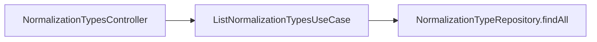

# Módulo: normalization-types

## Responsabilidade
Expõe os **tipos de normalização** da chave do produto (`Product.normalizedKey`): quais campos, além do nome, entram na chave usada para achar o mesmo produto entre sellers. Os tipos ficam na tabela `NormalizationType` (D-110), cadastrados pela migration `add_normalization_types`, e o módulo é **somente leitura**: não cria, altera nem remove tipos pela API.

O módulo também exporta o `NormalizationTypeRepository`, para a importação (PR 2) validar o tipo escolhido pelo código. Ele não monta a chave: a montagem continua no `ProductNormalizerService` do `catalog-import`.

## Endpoints
| Método | Rota | Descrição | Request | Response |
| ------ | ---- | --------- | ------- | -------- |
| GET | `/api/normalization-types` | Lista os tipos de normalização, em ordem de id | sem parâmetros | `ListNormalizationTypesResponseDto`: `items[{id, code, description, includesBrand, includesCategory}]` |

Erros: nenhum erro esperado. Falha inesperada (ex.: banco fora do ar) vira `500` pelo filtro global.

## Fluxo

`ListNormalizationTypesUseCase`: `findTypes` (repository, ordenado por id) -> `buildOutput` (mapeia só os campos públicos, sem `createdAt`/`updatedAt`).

## Regras de negócio
- Três tipos, com ids fixos (D-110):

  | Id | Código | Descrição | Marca | Categoria |
  | -- | ------ | --------- | ----- | --------- |
  | 1 | `NAME_BRAND` | Nome + Marca | sim | não |
  | 2 | `NAME_CATEGORY` | Nome + Categoria | não | sim |
  | 3 | `NAME_BRAND_CATEGORY` | Nome + Marca + Categoria | sim | sim |

- O **nome sempre** faz parte da chave. As flags `includesBrand` e `includesCategory` dizem o que entra junto.
- Formato da chave (implementado no PR 2): as partes incluídas, nesta ordem, `marca | categoria | nome`, cada uma normalizada pelo `ProductNormalizerService` e unidas por `|`. Exemplos para `Brand = "Samsung"`, `Category = "Electronics"`, `Name = "Galaxy S23"`:
  - `NAME_BRAND`: `samsung|galaxy s23` (exatamente a chave de hoje);
  - `NAME_CATEGORY`: `electronics|galaxy s23`;
  - `NAME_BRAND_CATEGORY`: `samsung|electronics|galaxy s23`.
- A chave é única **dentro do tipo**: unique composto `(NormalizationTypeId, NormalizedKey)` em `Product` (D-111). A mesma chave pode existir em tipos diferentes.
- Todos os produtos que já existiam ficam com `NAME_BRAND` e mantêm a chave exata (D-111). Até o PR 2, a importação grava e busca sempre com `NAME_BRAND` (`LEGACY_NORMALIZATION_TYPE_ID`), sem mudar o matching.

## Componentes
- `ListNormalizationTypesUseCase`: lista os tipos; único usecase do módulo.
- `NormalizationTypeRepository`: único acesso a `NormalizationType`. `findAll(tx?)` (ordenado por id) e `findByCode(code, tx?)` (pelo `Code` único, devolve `null` se não existir). Exportado pelo `NormalizationTypesModule`.
- Schemas: `normalization-type.types.ts` (enum `NormalizationTypeCode`, `NormalizationTypeRecord` e os tipos de saída) e o DTO `list-normalization-types.response.dto.ts` com `@ApiProperty`. Não há arquivo de erros: nenhum código de erro é usado ainda.
- Consts: `normalization-types.consts.ts` (`NORMALIZATION_TYPE_IDS`, ids fixos por código, e `LEGACY_NORMALIZATION_TYPE_ID`) e `normalization-types.swagger-examples.ts` (exemplo do 200, `satisfies ListNormalizationTypesOutput`).

## Decisões relacionadas
D-110, D-111 em `docs/decisions.md`. Também D-005 (regra da chave original), D-038 (exemplos do Swagger tipados) e D-055 (SQL manual nos testes de migration).

## Testes
- Unitário do usecase com `mockDeep<NormalizationTypeRepository>()`: lista na ordem do repository, lista vazia, nenhum campo extra exposto.
- Unitário do repository com `mockDeep<PrismaService>()`: ordenação por id, `select` só dos campos do record, uso do `tx`, `findByCode` com `null`.
- e2e (`test/normalization-types.e2e-spec.ts`) em banco temporário migrado: `GET /api/normalization-types` devolve os 3 tipos igual ao exemplo do Swagger, sem campos internos, e o endpoint aparece no `/api/docs-json` com a tag `normalization-types`.
- e2e da migration (`test/database/normalization-types-migration.e2e-spec.ts`): ver `docs/database.md`.
