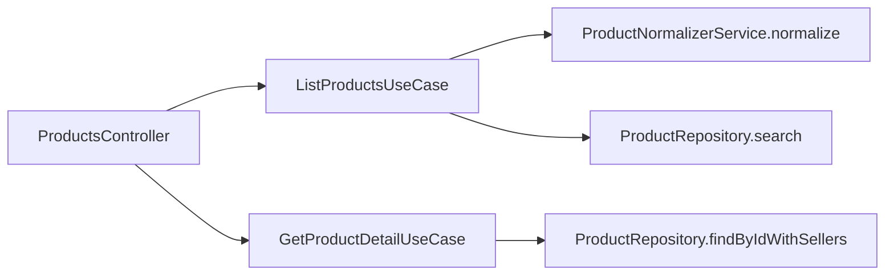

# Módulo: products

## Responsabilidade
Expõe o catálogo consolidado: listagem de produtos com busca e paginação, e o detalhe de um produto com os sellers que o oferecem. Não cria nem altera produtos pela API (a criação vem da importação, que usa o `ProductRepository`), e não grava `SellerProduct`.

## Endpoints
| Método | Rota | Descrição | Request | Response |
| ------ | ---- | --------- | ------- | -------- |
| GET | `/api/products` | Lista produtos com busca e paginação | query `q?`, `page` (padrão 1), `pageSize` (padrão 20, máx. 100) | `ListProductsResponseDto`: `items[{id, name, brand, category, sellersCount}]`, `total`, `page`, `pageSize` |
| GET | `/api/products/:id` | Detalhe do produto com sellers | `id` numérico | `GetProductDetailResponseDto`: `id, name, brand, category, sellers[{sellerId, sellerName, externalId, name, brand, category, matchedBy}]` |

Erros: `400` para parâmetros inválidos (`page`, `pageSize` ou `id`); `404` com `code: PRODUCT_NOT_FOUND` quando o id não existe.

## Fluxo

Listagem: `validatePagination` (função compartilhada, D-060) -> `normalizeQuery` -> `searchProducts` -> `buildOutput`. Detalhe: `findProduct` (devolve `PRODUCT_NOT_FOUND` quando o repository retorna `null`) -> `fillMissingSellerData` (fallback de `brand`/`category` para o produto oficial, D-014).

## Regras de negócio
- A busca ignora maiúsculas, acentos e espaços repetidos: o termo é normalizado e comparado com `contains` em `normalizedKey` (marca e nome normalizados).
- Termo vazio não filtra. O termo nunca é rejeitado nem "limpo" além da normalização, e vai parametrizado ao banco (sem SQL manual).
- Paginação: `page >= 1`, `1 <= pageSize <= 100`, com tipos, DTO de query e validação de `shared/pagination` (D-060).
- Ordenação estável por `id`.
- `sellersCount` é o número de `SellerProduct` do produto.
- O detalhe mostra os dados oficiais do produto e, para cada seller, os dados como ele enviou (D-013) e o `matchedBy` (D-015).
- `brand` e `category` que o seller não informou (`null` no banco) vêm do produto oficial, campo a campo (D-014). Só `null` cai para o oficial; texto do seller, mesmo vazio, vem como foi enviado. `externalId` não tem fallback.

## Componentes
- `ListProductsUseCase`, `GetProductDetailUseCase`: os dois casos de uso da API.
- `ProductRepository`: único acesso ao `Product`. Métodos: `findByNormalizedKey(key, tx?)`, `create(data, tx?)`, `search({ q, page, pageSize })`, `findByIdWithSellers(id)`. Os dois primeiros serão usados pela importação.
- `ProductNormalizerService`: registrado no módulo (D-070), vem do `catalog-import`.
- Schemas: `product.types.ts`, `products.errors.ts` (`PRODUCT_NOT_FOUND` registrado com `registerErrorStatuses`) e DTOs de request e response com Swagger. `ListProductsRequestDto` herda `page`/`pageSize` do `PaginationRequestDto` compartilhado e só acrescenta `q`.

## Decisões relacionadas
D-004, D-005, D-013, D-014, D-015, D-021, D-024, D-032, D-060, D-070 em `docs/decisions.md`.

## Testes
- Unitários dos usecases (lista vazia, paginação, paginação inválida, termo com acento, maiúscula e espaço duplo, termo malicioso, detalhe com vários sellers, fallback de `brand`/`category` para o oficial, texto vazio mantido, `null` quando os dois não têm, não encontrado).
- Unitários do repository com `mockDeep<PrismaService>()`, incluindo o uso do `tx`.
- e2e de cada endpoint com banco temporário migrado, incluindo `TestBrand'; SELECT 1; --`, `Levi's` e busca com termo malicioso.