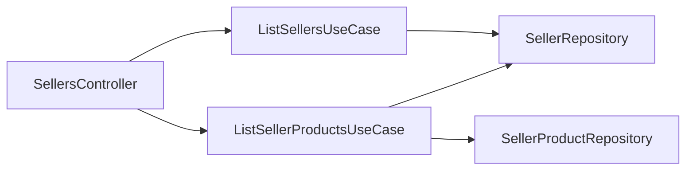

# Módulo: sellers

## Responsabilidade
Lista os sellers e os produtos de cada um, mostrando os dados **como o seller enviou** (nome, marca, categoria, `externalId`, `matchedBy`) junto com o produto oficial vinculado. Expõe os repositories `SellerRepository` e `SellerProductRepository`, que o módulo `catalog-import` usa na importação. Não cria sellers nem vínculos por HTTP (isso é feito pela importação) e não altera o produto oficial.

## Endpoints
| Método | Rota | Descrição | Request | Response |
| ------ | ---- | --------- | ------- | -------- |
| GET | `/api/sellers` | Lista sellers com a quantidade de produtos | query `page` (padrão 1), `pageSize` (padrão 20, máximo 100) | `ListSellersResponseDto` |
| GET | `/api/sellers/:id/products` | Lista os produtos de um seller | `id` (inteiro) + mesma paginação | `ListSellerProductsResponseDto` |

Erros: 400 (paginação ou `id` inválidos), 404 `SELLER_NOT_FOUND` (seller inexistente, só no segundo endpoint).

## Fluxo

`ListSellerProductsUseCase`: `validatePagination` -> `findSeller` (erro `SELLER_NOT_FOUND` se `null`) -> `listProducts`.

## Regras de negócio
- `null` em `brand`, `category` e `externalId` significa que o seller não informou o dado (D-014) e é devolvido como `null`, nunca como texto vazio.
- Os dados do vínculo são os do seller; o produto oficial vem só com `id` e `name`.
- Paginação: `page >= 1`, `1 <= pageSize <= 100`; ordenação estável (sellers por nome e id; vínculos por id).
- Textos (inclusive com aspas e SQL) são gravados e lidos exatamente como chegam: só há queries parametrizadas pelo Prisma.

## Componentes
- `ListSellersUseCase`, `ListSellerProductsUseCase`: um por endpoint.
- `SellerRepository`: `findByName(sellerName, tx?)`, `create(sellerName, tx?)`, `findById(id, tx?)`, `list(params, tx?)` (com `productCount`).
- `SellerProductRepository`: `findBySellerAndExternalId(sellerId, externalId, tx?)`, `findBySellerAndProduct(sellerId, productId, tx?)`, `create(data, tx?)`, `updateSellerData(id, {name, brand, category}, tx?)`, `listBySeller(sellerId, params, tx?)`. Todos aceitam `tx` opcional e retornam o dado ou `null`.
- Schemas: `seller.types.ts`, `sellers.errors.ts` (registra `SELLER_NOT_FOUND` -> 404, D-032), DTOs de paginação e de resposta com Swagger.

## Decisões relacionadas
D-002, D-007, D-008, D-012, D-014, D-024, D-032 em `docs/decisions.md`. Nenhuma decisão nova neste módulo.

## Testes
- Unitários dos dois usecases (sucesso, seller inexistente, paginação inválida, `null` preservado) com `mockDeep`.
- Unitários dos repositories com `mockDeep<PrismaService>()`, conferindo o uso do `tx`.
- e2e (`test/sellers/sellers.e2e-spec.ts`) em banco temporário migrado: listagem, paginação, 400, 404 e seller com nome malicioso (`x'; SELECT 1; --`) lido igual ao gravado.